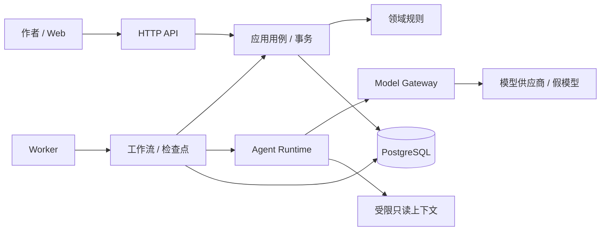

# 系统架构与工程边界

## 1. 架构选择

采用模块化单体：一个 Web 应用、一个后端代码包、HTTP 与 worker 两个运行进程、一套 PostgreSQL。先通过模块接口建立边界，暂不通过网络拆分核心能力。

以下是包含后续任务的**目标结构**。T00 已建立 `apps/web`、单个 `apps/api` Python 工程（配置、数据库适配、HTTP 健康端点、迁移、测试）、原生 PostgreSQL 运行说明与可选 Compose；领域、应用、Agent、仓储端口、worker、题材规则包尚未实现，不预建空业务模块：

```text
NovelOS/
├── apps/
│   ├── web/                       # Next.js / TypeScript
│   └── api/
│       ├── pyproject.toml
│       ├── src/novelos/
│       │   ├── domain/            # 实体、值对象、状态与业务不变量
│       │   ├── application/       # 用例、事务、工作流、上下文构建
│       │   ├── agents/            # Agent 协议、提示词与角色实现
│       │   ├── ports/             # 仓储、模型、时钟等抽象接口
│       │   ├── infrastructure/    # ORM、网关适配器、规则包加载
│       │   ├── api/               # HTTP schema、路由、异常映射
│       │   └── worker.py          # 持久化任务的领取与执行入口
│       ├── migrations/
│       └── tests/
├── plugins/genre/fantasy/          # manifest、schema、rules、fixtures
├── infrastructure/                # 可选数据库 Compose；当前不打包应用
├── docs/
└── AGENTS.md
```

不创建空的五个 `packages/*` Python 项目。领域边界稳定且存在独立复用/发布需求时，再讨论拆包。前端组件库也在出现真实复用需求后提取。

## 2. 调用和依赖方向



图中的数据库箭头代表通过仓储端口持久化，不代表领域直接依赖 ORM。

| 模块 | 拥有的职责 | 不负责 |
| --- | --- | --- |
| 领域 | 修订规则、正式/草稿边界、资产结构、验收不变量 | HTTP、模型调用、任务队列实现 |
| 应用 | 项目隔离、事务、乐观锁、ChangeSet 校验与应用、导出 | 自行拼接供应商请求 |
| 工作流 | 步骤顺序、持久化检查点、预算、重试、取消、等待人工 | 让模型决定是否可跳过验收 |
| Agent Runtime | 校验输入输出、绑定提示词与模型、实施工具白名单 | 数据库提交、任意文件或网络执行 |
| Model Gateway | 能力映射、超时、输出格式、用量归一化、供应商错误分类 | 剧情规划、正式记忆写入 |
| Context Builder | 按项目、章节边界和来源有效性检索，分配 token 预算 | 把整部小说无上限塞入提示词 |
| 基础设施 | 实现仓储、模型、配置和规则包加载端口 | 决定故事业务状态 |
| HTTP / Web | 参数与错误表达、任务操作、编辑与比较 | 跨过应用服务写正式数据 |

## 3. 技术基线

| 部分 | 选择 | MVP 约束 |
| --- | --- | --- |
| Web | Next.js、TypeScript、Tailwind；按需使用 shadcn/ui | Markdown 编辑优先，不引入图谱或富文本依赖来展示普通表单 |
| 后端 | Python、FastAPI、Pydantic、SQLAlchemy、Alembic | 一套 Python 依赖与迁移；HTTP schema 和领域对象分离 |
| 数据 | PostgreSQL | 正文、正式资产、记忆、任务、检查点都持久化 |
| 执行 | 独立 worker + 数据库领取任务 | 不依赖 HTTP 连接存活；有租约与崩溃恢复 |
| 模型 | Fake 适配器 + 一个实际供应商适配器 | 供应商/模型通过配置选择，记录真实模型标识 |
| 开发环境 | Node 24.12.0 / npm 11.6.2、Python 3.13.5 / uv 0.12.3、PostgreSQL 17.11 | 锁文件与运行命令见根目录 README；兼容依据和本机验证限制见 T00 记录 |

默认以本机进程运行 Web / API 和原生 PostgreSQL；Docker 不属于运行前置条件，也不要求提供应用 Dockerfile 或镜像。`infrastructure/compose.yaml` 仅是 PostgreSQL 的可选适配方式。两条路径使用相同数据库版本、连接配置、迁移与健康检查；可选容器路径未实测时单独记录，不阻塞已验证的原生路径。

Redis 缓存、Qdrant 检索、LangGraph 编排、React Flow 可视化均为后续适配选择。LangGraph 即使引入，也必须保留领域事务、任务审计与人工验收边界。

## 4. 运行过程

1. Web 调用 API 保存输入或提交任务；API 在事务中保存 `Run` 和幂等记录后返回 `202`。
2. worker 使用数据库行锁领取任务，设置租约；同一项目最多一个排队或执行中的任务，防止 MVP 出现无意义并行生成。
3. 应用构建固定输入快照，Agent 经网关生成，步骤输出和模型尝试写入数据库后才推进检查点。
4. 最终结果存为候选版本与 ChangeSet，任务进入 `awaiting_review`；作者离开浏览器不丢结果。
5. 作者验收时，应用锁定项目、检查输入基线，在同一事务更新正式正文、资产、记忆、修订号和任务状态。

没有数据库与向量库双写事务。后续增加索引时，以数据库 outbox 发布索引事件；消费幂等、可回放，检索结果仍需回查来源有效性。

## 5. 配置与隔离

- 只在后端加载供应商密钥；前端 bundle、API 响应、模型日志与导出文件不包含密钥。
- 工程初始化提供脱敏的 `.env.example`，不读取或重写现有 `.env`。配置按数据库、运行环境、供应商、模型路由、预算上限分组。
- MVP 只面向私有本地单作者；后端和数据库默认绑定回环地址。单用户也要按 `novel_id` 验证所有资源归属。
- Web 与 API 使用明确允许的来源，状态变更只接受 JSON 并校验请求来源；不要以“本地运行”为由开放任意来源写接口。
- 小说正文、检索片段、插件规则中的创作内容作为不可信资料放入上下文，不能改变系统权限或获取工具。
- 规则包从仓库固定目录加载，校验 manifest、路径和 schema；拒绝路径穿越和任意模块导入。

公网部署需要独立增加身份认证、项目授权、会话保护和运维设计，不属于本基线。

## 6. 可观测性与运维交付

结构化日志至少含 `request_id`、`run_id`、`step`、`attempt_id`、耗时和错误码；默认不记录完整输入、正文或密钥。模型使用量作为数据库记录保存，任务失败也能查看。

提供进程存活检查与数据库就绪检查。启动和迁移分开；数据库不可用时就绪检查失败，不能返回假成功。备份包含 PostgreSQL 和规则包/提示词版本的可恢复来源；模型响应重放需要已持久化的输出，不能指望同模型再次生成相同文本。

具体安装、运行、迁移与检查命令已由 T00 提供于根目录 README，实测范围见 [验证记录](t00-validation.md)。备份恢复演练留给 T09，不能用本设计替代运行证据。
