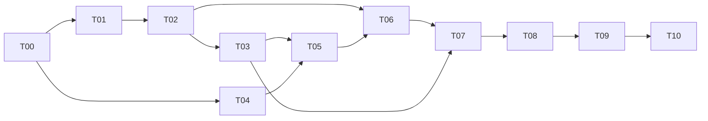

# 实施计划与任务契约

当前 **T00 / M0 已按默认原生运行路径验收完成**；T01–T10 均为**待开始**。按用户要求和 [D10](decisions.md#d10原生数据库为默认docker-compose-改为可选)，Docker Compose 改为可选，不再阻塞原生验收。这里的 Txx 是文档内编号，不代表已创建外部 Issue。实际结果与限制见 [验证记录](t00-validation.md)。

## 1. 里程碑与依赖

| 里程碑 | 任务 | 完成后可以做什么 |
| --- | --- | --- |
| M0 可复现工程（原生路径已完成） | T00 | 启动空应用、连接数据库、执行检查 |
| M1 手工创作闭环 | T01–T03 | 创建项目、维护设定/章纲、保存并比较正文版本 |
| M2 持久化 AI 能力 | T04–T06 | 用 Fake 或实际模型生成待验收规划，任务可追踪 |
| M3 单章生产闭环 | T07–T08 | 生成/审阅正文，人工验收并同步记忆，处理冲突与恢复 |
| M4 MVP 验证 | T09 | 导出、备份恢复，完整演示 P01–P09 |
| M5 长篇实验 | T10 | 获得至少 10 万汉字生产过程的实际评估报告 |

每个任务包含对应页面或演示入口，避免后端完成很久后才发现作者无法使用。实现顺序可随用户优先级调整，但必须补齐依赖；不要照旧样稿同时建完全部基础设施。

## T00：建立可复现工程骨架

**状态**：已完成（默认原生路径）。锁文件重装、Web 检查/构建/HTTP 冒烟、Python 检查已通过；按 D10 的默认 5432 端口和显式配置示例，在新建原生数据库上补验迁移、10 项后端测试、数据库断开与恢复，全部通过。Compose 配置通过、容器未验证的历史状态保留，不将其描述为完成，详见 [实际验证](t00-validation.md)。

**依赖**：无。**范围**：按 [架构](architecture.md) 创建 Web、后端和本地 PostgreSQL，建立配置加载、迁移工具与检查入口。

交付：运行时版本要求、依赖锁文件、脱敏 `.env.example`、原生 PostgreSQL 安装/初始化/启停说明、可选本地 Compose、API 存活/就绪检查、Web 空页面、实际可执行的开发与检查命令。只使用初始化时核实过的兼容依赖版本；不修改现有 `.env`，不加入 Redis/Qdrant，不要求应用镜像。

验收：从干净环境按 README 的默认原生路径可启动 Web/API/数据库；数据库不可用时就绪检查失败；一次初始迁移成功；格式、静态检查和最小健康检查可执行；锁文件可复现安装。可选 Compose 单独记录验证状态，不作为原生路径的阻塞项。记录实际命令与结果，配置不含真实密钥。

不包含小说业务和模型调用。完成后更新 README 的工程状态与运行说明。

## T01：项目生命周期与隔离

**依赖**：T00。**范围**：Novel 领域、迁移、仓储、创建/列表/读取/修改/归档 API 与项目列表页面。

交付：`canon_revision` 规则、固定规则包身份、项目配置 schema、通用错误与幂等骨架；此阶段可先用最小规则包 manifest 验证版本存在。

验收：新建和刷新项目可用；同幂等键不会产生重复项目，不同请求复用键报冲突；标题修改与生成约束修改遵守修订规则；归档后只读，可恢复。建立两个项目的隔离夹具，供后续复用；T05 引入任务后补齐存在未处理任务时禁止归档的检查。

覆盖 P01，验证 V01、V02、V03 的相关部分。

## T02：正式资产与章节规划

**依赖**：T01。**范围**：Volume、Chapter、StoryAsset/AssetVersion、玄幻数据规则包、结构化管理页面。

交付：类型 schema、引用校验、资产生效边界、章序约束、章节纲与场景计划表单；正式写入通过锁定 Novel 和预期修订校验。每次写入返回新修订，保持 UI 状态同步。

验收：人物/世界/事件/伏笔可创建编辑且形成版本；拒绝跨项目引用与非法字段；全局章序唯一连续；保存旧正式修订返回冲突。规则包错误版本、非法路径或 schema 加载失败有明确错误。先实现历史影响的计算接口/应用逻辑，T07 用真实正式稿验证失效行为。

覆盖 P02、P03 的手工路径，验证 V02、V03、V04。

## T03：不可变正文与安全编辑

**依赖**：T02。**范围**：ChapterVersion、草稿指针、正文计数、版本查询与比较、Markdown 编辑器。

交付：保存草稿 API、带来源的复制/回退操作、明确的保存状态、未保存离开提示。固化汉字与总字符计数规则，记录使用的 Unicode 范围。

验收：保存新增版本且不改变旧版本内容，不递增正式修订；两个标签页基于同一版本保存，第二次冲突并保留本地内容；回退生成新版本；正文与版本不能跨项目/章节引用；空正文等输入按 schema 处理。

覆盖 P05，验证 V02、V05、V06、V18。

## T04：模型网关与可复现假模型

**依赖**：T00。**范围**：类型化模型请求/响应、能力协商、错误映射、超时、用量与 Fake 适配器。

交付：Fake 的确定性正常/限流/非法结构/超时/未知用量场景；一个真实供应商适配器和显式启用方式；提示词资源版本约定；不含敏感配置的能力发现 API。真实供应商在实施时根据可用配置选定，不假设已有密钥。

验收：业务用例不直接引用供应商 SDK；Fake 离线运行；不支持的能力提交前报错；日志/HTTP 响应没有密钥；用量未知与零用量可区分。真实适配器无凭据时可跳过联调，但必须记录“未验证”，不能宣称接入成功。

验证 V12、V13、V15 的网关部分。

## T05：持久化任务、检查点与受限 Runtime

**依赖**：T03、T04。**范围**：Run、StepAttempt、幂等记录、独立 worker、租约、AgentContext/Result、预算与有限重试。

交付：提交/查询/取消/重试 API，任务记录基础 UI；使用无正式数据副作用的测试工作流验证状态机。每项目执行槽由数据库约束保证，不仅靠进程内锁。

验收：提交立即返回持久化任务 ID；重启 API 不丢任务；重启 worker 可恢复已保存步骤，不重复调用成功步骤；丢失租约的旧 worker 无法写入检查点；结果未知不自动重发；同项目并发提交只有一个活动任务；取消后不启动新步骤。预算预留和失败用量保留，归档与任务创建竞态遵守项目锁和归档规则。

覆盖 P04、P07 的基础设施，验证 V09–V14。

## T06：规划提案与人工接纳

**依赖**：T02、T05。**范围**：Planner、`plan_novel`、有限 ChangeSet schema、接纳/拒绝事务与提案页面。

交付：创意到资产/卷章规划提案；临时引用解析、硬规则校验、生成快照；提案整批比较与验收。只应用有限领域操作，不开放任意 patch。

验收：生成提案不改变正式数据；拒绝无正式副作用；验收所有操作同事务成功；中途注入失败全部回滚；旧修订提案不能验收；重复验收只生效一次。审阅页面能区分新建和修改对象。

覆盖 P03 的 AI 路径、P06 的规划路径，验证 V03、V07、V08。

## T07：章节生成、人工稿审阅与正式记忆

**依赖**：T03、T06。**范围**：Context Builder、Writer、Editor、Critic、Memory Extractor、`generate_chapter` / `review_chapter`、MemoryRecord。

交付：可解释上下文快照、按章边界的检索、最终版本一致的审稿/摘要/资产变化、原子验收、历史失效与按序重新确认。单次 Editor 后不添加自动循环。

验收：Fake 完整生成第一章，作者验收后下一章能引用其有效摘要/状态；未验收或其他项目内容不进入上下文；人工修改后旧提案过期，新正文可单独审阅；正文/资产/记忆事务失败不留部分提交；替换前章后下游失效且旧来源不可检索；重新审阅恢复有效链路。

覆盖 P04、P06、P08，验证 V02、V07、V08、V14、V16、V17。

## T08：工作区恢复与异常路径整合

**依赖**：T07。**范围**：整合已逐步交付的页面，补齐候选比较、警告确认、历史影响确认、任务恢复、配置和空状态。

交付：刷新/切换恢复、候选采用后编辑、过期解释、费用未知状态、键盘与窄屏可用性。所有决策按钮绑定正确的版本、正式修订与幂等键。

验收：完成 [交互设计](ux.md) 中四条端到端路径；取消与验收竞态有一致最终状态；AI 完成时不覆盖未保存正文；冲突不丢稿。界面区分 Fake、实际模型、草稿、正式稿及待审任务。

覆盖 P05–P08 的完整用户路径，验证 V05、V06、V09、V14、V16。

## T09：导出、恢复与 MVP 验收

**依赖**：T08。**范围**：正式 Markdown 快照导出、数据库备份恢复说明、运行文档、集成与端到端检查。

交付：按章序导出、失效阻断、导出修订标识；从新数据库恢复的实际演练；全部 P01–P09 与 V01–V18 的检查结果；一个从建项目到验收两章的 Fake 演示夹具。

验收：导出只含有效正式版本且章序正确；备份恢复保留版本/任务/记忆来源；文档命令从干净环境执行成功；实际模型若可用，完成一章并记录配置、用量和人工检查结果，若不可用明确列为待验证能力。所有 MVP 关键一致性检查通过才标记 M4 完成。

覆盖 P09，验证 V18 并汇总全部场景。Fake 演示通过与真实写作验证分别报告。

## T10：10 万字长篇实验

**依赖**：T09；另需可用真实模型、明确预算和作者参与。**范围**：按章推进一部至少 10 万汉字的玄幻实验作品，不新增自动批量生产能力来绕过人工验收。

交付：实验配置、逐章用量/失败/人工修改记录、事实与伏笔检查样本、总成本及未知项、备份与实验结论。实验资料默认本地保存，公开与否另定。

验收：达到有效已验收汉字数门槛；所有版本、来源与上下文可追溯；完成跨卷/长距离伏笔和人物状态的人工抽查；没有未解决的数据隔离或原子性问题。列出创作质量缺陷，不将“字数达标”当成文笔和商业质量达标。

真实模型调用按实验预算显式开展，不属于 T00 工程初始化范围。

## 2. 统一完成条件

任务完成必须同时满足：交付物存在、对应验收场景执行、关键契约同步、结果可复现。汇报包括改动、实际验证与限制；未验证外部依赖保持待验证，不用下一任务建议代替本任务验收。

后续能力按实际证据立项：检索质量不足再评估语义索引，编排恢复复杂再评估 LangGraph，作者确有关系导航需求再做图谱。都市题材、自动导演和百万字实验各自需要产品范围与验收，不直接沿用样稿编号开工。
